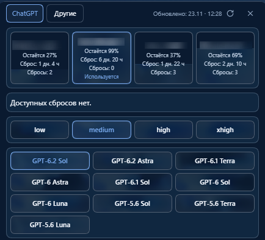
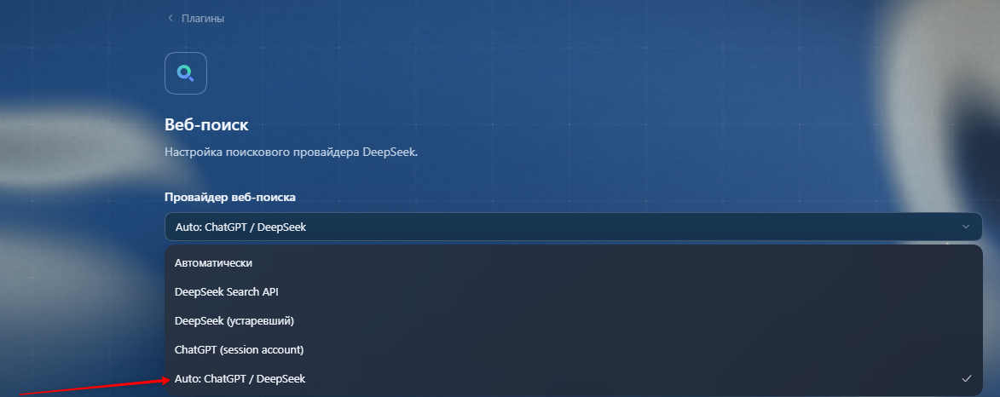

# ChatGPT Multi-account for DeepSeek Harness

Несколько аккаунтов ChatGPT с независимым выбором для каждой сессии DSH, компактным выбором модели и отображением оставшихся лимитов подписки. · [简体中文简介](#中文简介)

**Версия 0.5.4 · community-плагин.** Установка и обновления этой копии: [GitHub](https://github.com/TheSeeker1993/dsh-chatgpt-multi-account). Исходный проект: [GitFlic](https://gitflic.ru/project/421-mircli-ru/dsh-chatgpt-multi-account). Для доработки начните с [AGENTS.md](AGENTS.md) и [карты проекта](docs/PROJECT.md).

Целевой диапазон DSH: **>=0.2.2-rc.3 <0.2.3**, pi-ai **1.3.0**. API и native synthetic smoke ориентированы на установленный DSH **0.2.2-rc.3**; это не подтверждение живого платного поиска или визуальной проверки. Это не официальный продукт OpenAI или DeepSeek.



## Возможности

- Несколько OAuth-аккаунтов ChatGPT, отдельные хранилища и обновления токенов.
- Сохраняемый выбор аккаунта для каждой сессии, без автоматического перехода на чужой аккаунт.
- Компактный немодальный виджет возле кнопки выбора модели; четыре одинаково оформленные панели: аккаунты, ручные сбросы, рассуждения, модели. Старые скриншоты могут показывать прежний веер.
- Анимированная заливка снизу вверх показывает оставшийся лимит: 100% — полная карточка, 50% — половина. Недельное окно имеет приоритет; при его отсутствии используется первое основное окно. Неизвестные данные не изображаются полным остатком.
- У каждой карточки независимые фаза, направление и скорость переливов. При наведении яркость и скорость возрастают, но высота заливки не меняется; уход курсора не перезапускает фазу.
- Уменьшенное движение ОС отключает анимации и переходы; аккаунты расположены сеткой с адаптацией к узкому экрану.
- Отдельные вкладки ChatGPT и остальных провайдеров.
- Оставшийся процент лимита, полоса, время до сброса, время обновления и ручное обновление.
- Общий стиль карточек и пружинный отклик; отдельный блок «Недельный лимит» удалён. Остаток, countdown и число ручных сбросов видны на аккаунтах.
- Карточки доступных полных сбросов Codex автоматически показываются ниже выбранного аккаунта. Указаны срок действия и описание; расходование только после двух отдельных предупреждений, привязанных к точному аккаунту и сбросу. Автоматических покупок или сбросов нет.
- При неопределённом сетевом результате запрос использования не повторяется автоматически. Подтверждения действуют не более минуты и аннулируются при смене аккаунта/авторизации. Ручной сброс разрешён и во время работы аккаунта; он не перезапускает и не повторяет текущий запрос ИИ. При повторной авторизации сброс заблокирован.
- Поддержка наследования аккаунта встроенными субагентами.
- Интерфейс следует выбранному языку DSH: русский, английский, упрощённый китайский, японский, испанский, французский, немецкий и португальский.

Проценты — это расход лимита подписки ChatGPT по временным окнам, **не точный счётчик токенов**. Доступные окна и модели зависят от вашей подписки и каталога установленного DSH.

## Установка и обновление

[Последняя версия и список изменений](https://github.com/TheSeeker1993/dsh-chatgpt-multi-account/releases/latest) · [Скачать установочный архив](https://github.com/TheSeeker1993/dsh-chatgpt-multi-account/releases/latest/download/dsh-chatgpt-multi-account.tgz)

### Из GitHub Releases — без Git

В **Плагины → Добавить плагин** вставьте ссылку на готовый пакет:

```text
https://github.com/TheSeeker1993/dsh-chatgpt-multi-account/releases/latest/download/dsh-chatgpt-multi-account.tgz
```

Эта ссылка скачивает пакет из последнего обычного релиза. Если на странице плагина DSH не предлагает кнопку **Обновить**, используйте [последний релиз на GitHub](https://github.com/TheSeeker1993/dsh-chatgpt-multi-account/releases/latest). Если менеджер отклоняет установку поверх старой версии, удалите старый пакет через менеджер и установите новый архив по той же ссылке.

### По ссылке на Git-репозиторий

В Маркете DSH откройте установку по ссылке (или выберите **Плагины → Добавить плагин**) и вставьте:

```text
https://github.com/TheSeeker1993/dsh-chatgpt-multi-account
```

Используйте ссылку на репозиторий без указания ветки, тега или коммита. Маркет будет проверять версию в ветке GitHub по умолчанию (`main`). Публикация в npm не нужна.

### Из локальной папки для разработки

```sh
git clone https://github.com/TheSeeker1993/dsh-chatgpt-multi-account.git
```

В менеджере плагинов DSH выберите **Добавить плагин** и укажите абсолютный путь к полученной папке. Собранные runtime-файлы уже включены: для установки не нужны `npm install` и TypeScript. Не удаляйте/не перемещайте папку, если менеджер создал ссылку на неё.

**Безопасная замена прежних версий:** bundle отключает строки `codex-link` и `chatgpt-multi-account` при включении новой строки `chatgpt-unified-project` (также отключаются известные локальные preview-версии). Старые пакеты остаются установленными для отката; авторизации не удаляются. На чистом профиле предупреждения об отсутствующих необязательных старых строках безвредны. Другие реализации того же провайдера/API с иными row IDs нужно отключить самостоятельно. После установки проверьте, что активна только одна реализация `chatgpt-session`.

Этот пакет самостоятельный: upstream `dsh-gpt-link` устанавливать не нужно. Плагин не переписывает конфигурацию остальных LLM-провайдеров. После установки обновите страницу DSH; при требовании менеджера перезапустите приложение.

## Начало работы

1. **Настройки → ChatGPT Link → Добавить аккаунт**. Укажите понятное название.
2. Нажмите **Войти через ChatGPT** и самостоятельно завершите OAuth-вход в браузере. Проверьте, что вошли именно в нужный аккаунт.
3. Если настройки по умолчанию включены, в новом чате больше ничего настраивать не нужно: при первом подключении плагин предлагает GPT‑6.2 Sol с уровнем `low`. Это относится к действительно новым чатам, а не к уже открытым или восстановленным.
4. Для ручной настройки откройте меню модели и вкладку **ChatGPT**. Нажмите карточку аккаунта — привязка сохраняется сразу. Затем нажмите модель, если хотите её сменить, или выберите уровень рассуждений для активной модели. Повторно нажимать модель после изменения уровня не нужно.

Если текущая GPT-модель не подтверждена для выбранного аккаунта, привязка не меняется, пока вы явно не выберете доступную модель. В чате DeepSeek выбор аккаунта сохраняет привязку для ChatGPT, но не переключает провайдера. Название карточки — ваша метка, а не подтверждённый email OAuth.

### После входа: веб-поиск по модели (необязательно)

После подключения ChatGPT-аккаунта откройте **Настройки → ChatGPT Link → Веб-поиск по модели**. Там виден текущий выбор DSH. Если используется поиск DeepSeek, он может расходовать лимит DeepSeek или тарифицироваться на стороне DeepSeek даже в чате ChatGPT. Это касается веб-поиска, а не обычных сообщений.

Чтобы поиск в чатах ChatGPT шёл через ChatGPT, нажмите **«Включить поиск по модели»** и подтвердите смену провайдера для профиля. Или выберите **Auto: ChatGPT / DeepSeek** вручную в **Настройки → Веб-поиск → Провайдер веб-поиска**. Для остальных моделей этот режим использует штатный поиск DeepSeek с его текущими настройками тарификации. Загрузка страниц (Fetch) не меняется. Подробнее — в разделе [«Поиск по модели чата»](#поиск-по-модели-чата).



### Расширенный режим

Включите **«Расширенный режим»** в **Настройки → ChatGPT Link** или внизу виджета выбора модели, если хотите видеть подробные карточки аккаунтов, остатки квот и доступные ручные сбросы Codex. Для обычного выбора аккаунта и модели включать его не нужно. Это настройка отображения, а не права администратора DSH; пароль не запрашивается. Сам сброс не запускается при включении режима: для расходования выбранного сброса по-прежнему нужны два отдельных подтверждения.

### Настройки для новых чатов

Чекбокс **«Для новых чатов»** справа от вкладок виджета сохраняет просматриваемый аккаунт, текущую выбранную модель ChatGPT и выбранный уровень рассуждений. Для сохранения другой модели сначала примените её в текущем чате, затем снова откройте виджет и отметьте чекбокс. Если комбинация совпадает с сохранённой, чекбокс уже отмечен. Его снятие отключает автоматическую настройку будущих чатов.

Если сохранённой настройки ещё нет, после подключения первого доступного аккаунта плагин выбирает **этот аккаунт + GPT‑6.2 Sol + Низкий**. Сохранённый выбор переживает перезапуск и используется только при создании новых обычных чатов. Старые/восстановленные чаты, forks и уже созданные субагенты не переключаются. Субагенты новых чатов по-прежнему наследуют их аккаунт. Это метаданные в отдельном домене `chatgpt_defaults`, без копирования credentials и без изменения глобальной модели DSH.

Если сохранённый аккаунт удалён или вышел из системы, другой аккаунт автоматически не выбирается: восстановите авторизацию либо явно сохраните новую комбинацию в существующем чате. При включённом недоступном default создание нового чата завершается явной ошибкой, а не запросом от чужого аккаунта.

### Исходный/общий аккаунт

Если ранее был выполнен вход через встроенный OpenAI Codex, плагин показывает `ChatGPT · текущий аккаунт` с ID `legacy`. Он использует прежнюю запись авторизации без копирования токенов. Его нельзя удалить через этот интерфейс. Старый провайдер **openai-codex**, если включён вашей конфигурацией, использует этот общий аккаунт и не учитывает выбор аккаунта сессии.

Для изоляции используйте **ChatGPT (session account)**, ID `chatgpt-session`.

## Поиск по модели чата

В **Настройки → Веб-поиск (Settings → Web Search)** явно выберите **Auto: ChatGPT / DeepSeek** (`model-aware-search`). Установка и загрузка плагина никогда не выбирают поиск автоматически и не меняют настройки. Отдельный провайдер **ChatGPT (session account)** (`chatgpt-session-search`) также доступен в штатном списке. Настройки Fetch и способ загрузки страниц не меняются.

- Auto использует фактический маршрут запроса, вызвавшего инструмент, а не текст запроса или текущий глобальный выбор модели. Для `chatgpt-session` используется ровно привязанный аккаунт и общие native credentials/leases. Для `openai-codex` — всегда исходный `legacy`, независимо от селектора аккаунта сессии.
- GPT-поиск выполняется фиксированной вспомогательной моделью **`gpt-6.1-sol`, low reasoning**, через native ChatGPT OAuth. Передаётся только поисковая фраза, без истории чата и replay. Эта модель не обязана совпадать с моделью диалога. Источники берутся из завершённого hosted web search, не из произвольных ссылок в тексте ответа.
- Отдельный OpenAI API-ключ не требуется. **Поиск расходует allowance ChatGPT; точное списание не измерено. Это не обещание бесплатного или безлимитного поиска.**
- DeepSeek и прочие не-GPT маршруты используют штатный DeepSeek Search с его существующими настройками авторизации, endpoint, count, throttling и `searchBilling`, включая обычную тарификацию. При отсутствии инициатора/маршрута — ошибка. Ошибки, лимиты и отсутствие авторизации не вызывают перехода на другой backend или аккаунт.
- Для отключения Auto выберите **штатный DeepSeek** в том же экране Веб-поиска. Credentials, привязки, история и Fetch сохраняются.

API Host DSH **0.2.2-rc.3** изучены по установленным исходникам. Живой платный поиск и визуальная проверка этой интеграции не выполнялись; результаты проверок из приложенного ТЗ не являются проверкой данной сборки.

## Безопасность и ограничения

- Токены хранятся в DSH Credentials на вашем компьютере; не в конфиге, GitHub или данных UI. Защита на диске определяется credential backend вашей установки DSH.
- Метки аккаунтов и привязки сессий сохраняются в отдельном DSH Storage domain `chatgpt_accounts`.
- Нет автоматической балансировки, обхода лимитов или смены аккаунта при ошибке. Отсутствующий выбор/удалённая авторизация вызывают ошибку.
- Нельзя менять аккаунт работающей сессии, удалять занятый аккаунт или повторно входить в него во время использования.
- Встроенные субагенты наследуют выбранный аккаунт родителя при первом запросе; обычные новые сессии и ветки требуют отдельного выбора.
- Системные вызовы без session ID не могут использовать session-account route. При необходимости оставьте системную модель на другом провайдере.
- При смене аккаунта текст истории сессии останется и будет отправляться новому аккаунту. Account-bound replay IDs не переиспользуются между аккаунтами.
- Удаление аккаунта удаляет **локальные** credentials, но не гарантирует отзыв сеанса у OpenAI. При необходимости завершите сеанс в ChatGPT → Безопасность → Активные сеансы.
- Квота может быть устаревшей или недоступной. Просроченный OAuth-токен обновляется нативным pi-ai при запросе модели; карточка квоты сама refresh не выполняет.
- OAuth-вход использует нативную реализацию pi-ai. Входите по одному аккаунту за раз; при конфликте callback-порта завершите другой OAuth-вход.
- На узком экране сетки адаптируются; основной список прокручивается вертикально. Виджет открывается возле вызывающей кнопки и ограничивается размерами окна.
- Совместимость модели/подписки, доступность ChatGPT и соответствие условиям OpenAI — ответственность пользователя. Плагин не обещает доступ к моделям вне вашей подписки.

## Модели субагентов

В настройках ChatGPT Link откройте блок **«Модели субагентов»**. Кнопка **«Настроить субагентов»** показывает семь маршрутов `chatgpt-session/...`; только после отдельного подтверждения включается выбор моделей и они добавляются к разрешённым. Остальные маршруты сохраняются, включая ранее отмеченные `openai-codex/...`: если они не нужны, снимите их в **Плагины → Официальные → Субагент**. При установке никаких разрешений автоматически не меняется.

Разрешения применяются **только к новым чатам**. Для `chatgpt-session` субагент наследует выбранный аккаунт родителя; уже созданный субагент сохраняет прежнюю привязку. Не используйте `openai-codex` вместо `chatgpt-session`, если нужна эта привязка.

Статус можно обновить вручную. Недоступные, read-only настройки и конфликт параллельного сохранения показываются ошибкой, без скрытого повторного сохранения. Используется штатный settings API установленного DSH 0.2.2-rc.3; на другой версии при недоступном API используйте официальный экран Subagent.

## Обновление и откат

Если плагин установлен по ссылке GitHub выше, откройте **Маркет → Установленные** и нажмите **Обновить**, когда Маркет предложит новую версию. Перед обновлением завершите активные запросы и следуйте подсказке о перезапуске. Для публикации обновления достаточно повысить `version` в `package.json` и отправить коммит в `main` на GitHub; отдельный GitHub Release не требуется.

Если плагин был установлен с GitFlic, один раз установите его поверх текущей версии по ссылке GitHub выше, чтобы сменить источник. Локальные копии обновляются через Git. Не включайте две реализации `chatgpt-session` одновременно.

## Разработка и тесты

Node.js 24+:

```sh
npm test
npm pack --dry-run
```

`npm test` проверяет JS-синтаксис и синтетические тесты авторизации, квот, параллельных запросов, leases, наследования, replay isolation и поиска. Они используют синтетические credentials и не входят в ваши аккаунты. Полный набор текущей рабочей версии с defaults: **165 тестов, 0 ошибок и пропусков**. Оба installed-runtime smoke прошли на Electron 44.7.0 / DSH 0.2.2-rc.3, включая реальный native Models с синтетическим OAuth refresh; без сети и доступа к профилю.

`src/` и `lib/` сохраняют upstream-модули. Новые серверные модули: `multi/`; UI: `client/index.js`. Для пересборки upstream TypeScript при его изменении установите devDependencies и выполните `npm run build`. CI не публикует npm-пакет автоматически.

Проверка двух реальных аккаунтов, focus/scroll поведения и совместимости конкретной версии DSH требует ручного интеграционного теста. Автотесты не заменяют такую проверку.

## English quick start

Install `https://github.com/TheSeeker1993/dsh-chatgpt-multi-account` via DSH Market or Plugin Manager, without a branch, tag, or commit suffix. In DSH Market, use **Installed → Update** when a newer version is offered. For development, you can clone the repository and add its absolute local directory through Plugin Manager instead. Disable other ChatGPT Link implementations first. Add and explicitly sign into accounts under Settings → ChatGPT Link. In a session, select a ChatGPT account to save its binding immediately. Click a model to change it, or choose a supported reasoning level to apply it to the active model. If the current GPT model is not confirmed for the selected account, explicitly choose an available model before rebinding. The `chatgpt-session` provider is account-isolated; legacy `openai-codex` is not. Quotas are subscription limits, not token counts. Target engines: DSH >=0.2.2-rc.3 <0.2.3 / pi-ai 1.3.0. Installed rc.3 API inspection and synthetic native smoke do not certify live search or visual behavior.

For model-aware search, explicitly select **Settings → Web Search → Auto: ChatGPT / DeepSeek** (`model-aware-search`); loading this plugin never changes settings. Standalone `chatgpt-session-search` is also available. GPT search uses fixed `gpt-6.1-sol` / low reasoning with native OAuth and no chat history; it consumes ChatGPT allowance (exact cost unmeasured), not a free/unlimited service. `chatgpt-session` uses the bound account; legacy `openai-codex` always uses `legacy`. Other routes use native DeepSeek with existing billing/settings, without cross-fallback. Fetch is unchanged. Select native DeepSeek to turn Auto off. Host rc.3 APIs were inspected; no live paid-search or visual verification of this integration was performed.

## 中文简介

这是一个面向 DeepSeek Harness（DSH）的社区插件。它支持连接多个 ChatGPT OAuth 账号，为每个会话单独选择账号、模型和推理强度，并查看各账号的剩余额度。会话不会自动切换到其他账号。连接了可用账号且未更改默认设置时，新建普通会话的初始默认模型为 **GPT‑6.2 Sol**（低推理强度）。

**高级模式**可在 **设置 → ChatGPT Link** 或模型选择器底部开启，无需输入密码。它会显示扩展的额度信息和可用的 Codex 手动重置选项，不会授予任何 DSH 管理权限。使用一次手动重置额度仍需两次独立确认；插件不会自动使用或购买重置额度。

## License and attribution

MIT. Based on [Clukay-Fun/dsh-gpt-link](https://github.com/Clukay-Fun/dsh-gpt-link), upstream commit `c2110c8d818445c398b14f0f1d5a5aa30e992aed`, version 0.2.0. Original copyright/license and icon attribution are retained. Multi-account implementation and UI modifications maintained by [qixxby](https://github.com/qixxby). See [LICENSE](LICENSE) and [NOTICE.md](NOTICE.md).
